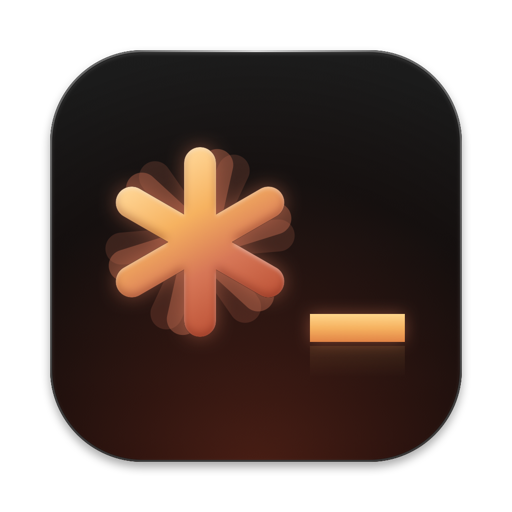
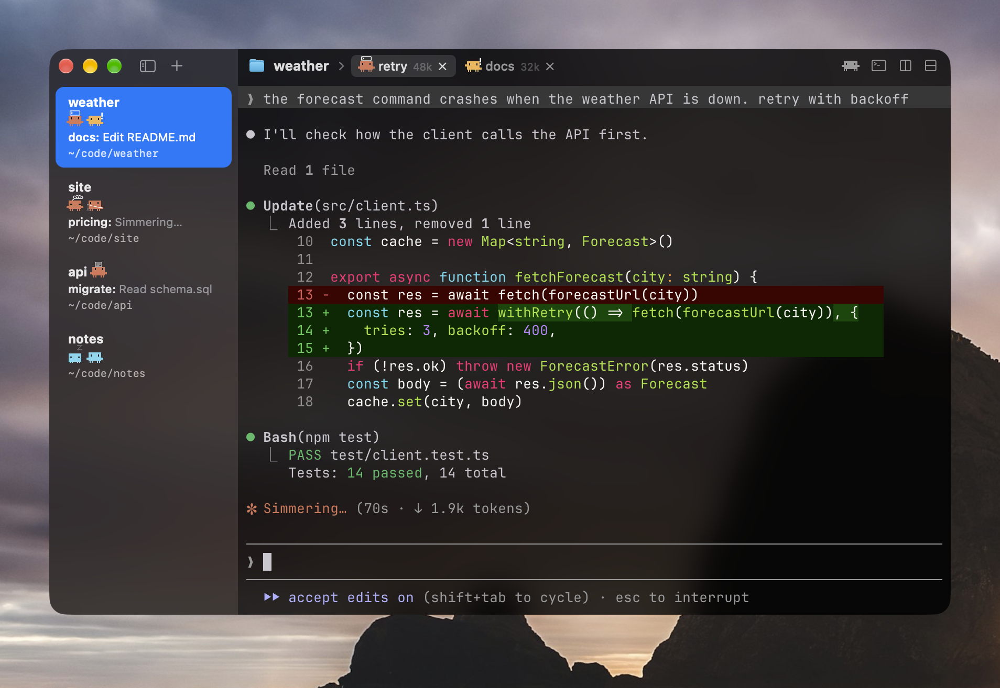
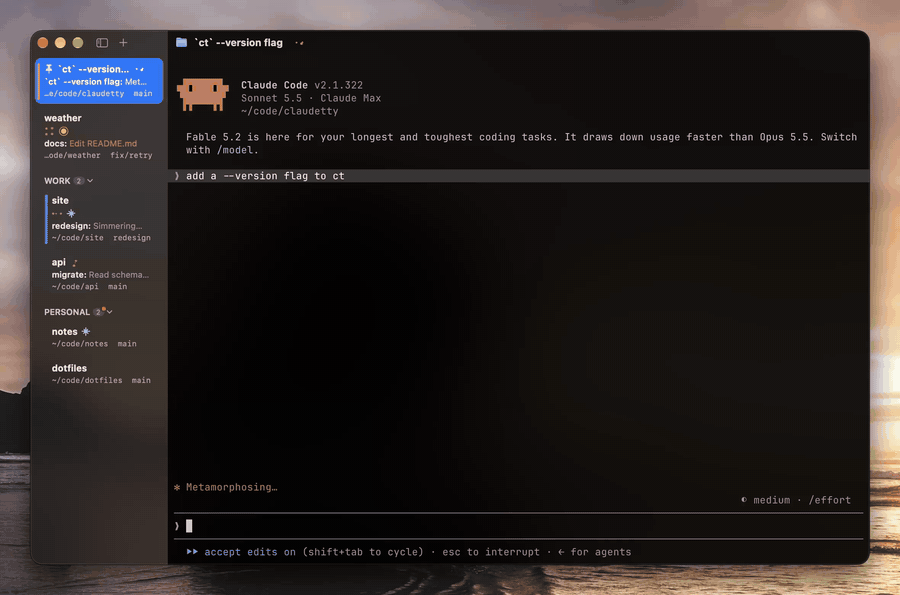
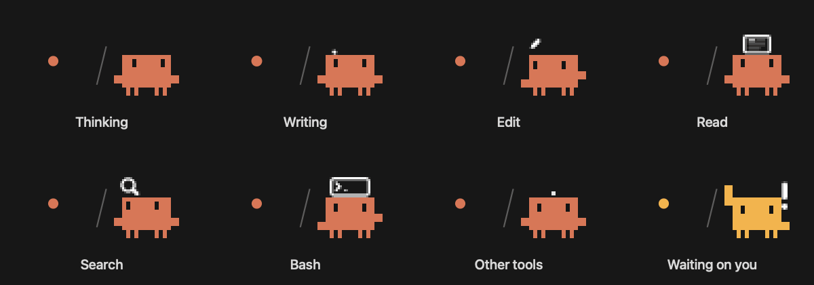
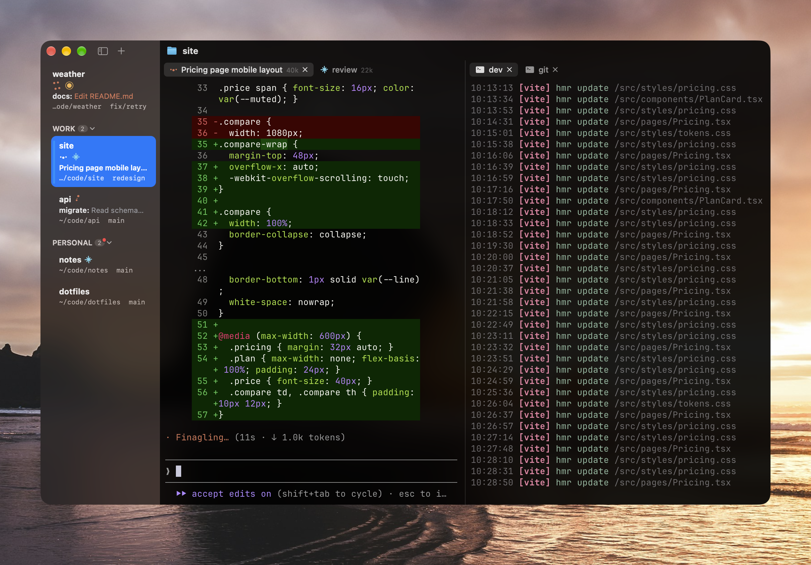
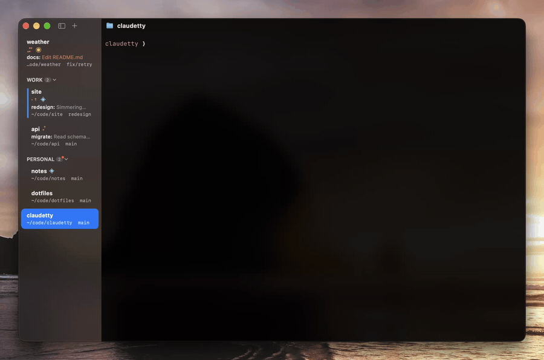
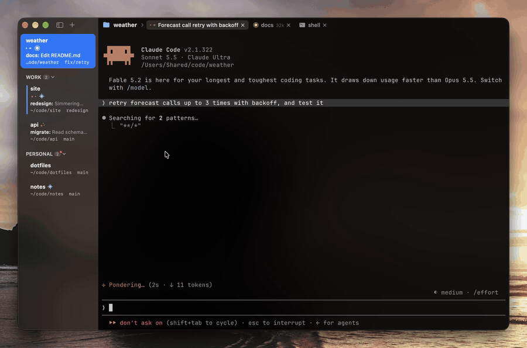

<div align="center">
  <p> </p>
  <p>A fast, undying cmux for Claude Code.</p>
  <p><a href="https://github.com/aqilc/ClaudeTTY/releases/latest/download/ClaudeTTY.dmg"></a><br><sub>macOS 26 or later, Apple Silicon</sub></p>
</div>



Looks (top tier, animated throughout)
-------------------------------------



### Persistent Tabs

Every tab runs in a [zmx](https://github.com/neurosnap/zmx) session outside the app, like tmux without the tmux. Quit it, crash it or update it, and every session is still mid-edit when you open it again. Same when Claude Code updates itself. The sessions you already had open stay up and still get tracked. After a reboot I get each tab back in its group with `claude --resume`.

<br clear="all"><br>



### Dots and Clawd

Pick Dots or Clawd in View > Icons. When a session needs you its tab turns amber, even if it's one of 4 in a group. You can also see how much context each tab has used.

<br clear="all"><br>



### Groups and panes

I keep each project in a group and its sessions as tabs. I color and pin groups, and the splits and shortcuts are the ones you know from iTerm, and <kbd>⌘</kbd>-click opens links and file paths even while Claude Code has the mouse.

<br clear="all"><br>



### Modding it

3 files and 8,500 lines of easily moddable Swift. Change something (or ask Claude to), run `./install.sh` and the open window switches to the new build like magic, tabs and all.

<br clear="all"><br>



### Animations and polish

I made dragging tabs, groups and the sidebar feel right. Dragging the sidebar shut is pretty satisfying, or <kbd>⌘</kbd><kbd>B</kbd> for less satisfaction but some more practicality.

<br clear="all"><br>

Smaller Things I Like
---------------------

- **Chrome-style tab sleeping** after 20 idle minutes, about 500 MB saved per tab, waking into the same session. Right-click the sidebar for the total.
- A cold cache turns a sleeping Claude icy cyan. ClaudeTTY > Keep Asleep Tabs Warm prevents it.
- Right-click a tab for its model, effort and context.
- The sidebar names the background command a session is waiting on, and its Clawd goes fishing.
- Click "3 subs" under a group to watch a subagent work live.
- **Updates Claude Code in the background** for long running sessions automatically whenever they're free.
- Idle sessions leaking past 400 MB restart into the same session.
- **One shared copy of each MCP server** for every tab, instead of ten Supabase servers for ten sessions.
- Idle groups show their session's last message. I'd forget what half of them were doing otherwise.
- The dots don't strobe when a session flies through quick file reads.
- The tab bar picks up vim's background color, or any app's.
- <kbd>⌘</kbd>-click opens files in your editor through `~/.config/claudetty/open`.
- <kbd>⌘</kbd><kbd>P</kbd> <kbd>↩</kbd> is basically <kbd>⌘</kbd><kbd>Tab</kbd> for tabs.
- Right-click a tab to **schedule a message for when your limits reset**.

Compared to cmux and Others
---------------------------

| | ClaudeTTY | cmux | herdr | Superset | Warp | Wave | Ghostty |
|---|:-:|:-:|:-:|:-:|:-:|:-:|:-:|
| Tabs keep running after a quit or crash | ✅ | only through tmux | until its server restarts | ✅ | ❌ | SSH only, opt-in | ❌ |
| Shows what each session is doing | ✅ | a needs-attention ring | working and blocked | working and done | with its plugin | ❌ | ❌ |
| Claude can run other tabs | ✅ | CLI and socket | CLI and socket | CLI, MCP and SDK | ❌ | `wsh` CLI | ❌ |
| Memory with one idle tab | 68 MB | 1,029 MB (15×) | 109 MB | 359 MB | 895 MB | 556 MB | 84 MB |
| Idle CPU | 0.03% | 3.1% (103×) | 0.9% | 1.9% | 3.2% | 1.9% | 0.7% |
| Launch to first window | 307 ms | 701 ms | not timed | 889 ms | 829 ms | 1,226 ms | 302 ms |
| App size | 20 MB | 454 MB | 86 MB | 1.5 GB | 872 MB | 531 MB | 62 MB |

<sub>All on my M4 Pro (48 GB) with macOS 27.0 and one window with one tab. Launch is the median of 5, memory is Activity Monitor's footprint 20 s after launch (mine includes zmx) and CPU is over the 30 s after that. herdr runs inside your terminal, so its numbers include Ghostty.</sub>

That 68 MB is just the app though. Each Claude Code is about 500 MB and a bit of idle CPU on its own, and sleeping tabs save way more than the whole app uses.

Letting Claude Run Your Tabs
----------------------------

A Claude Code plugin and a `ct` command let the session in one tab open, watch and steer the others:

```sh
ct list                          # every tab, its group, folder and Claude state
ct web dev bun run dev           # open tab "dev" in group "web", running a command
ct split dev right agent claude  # a new pane beside it with Claude in it
ct wait agent idle               # block until that Claude is done
zmx send agent "run the tests"   # type into it
```

Don't even look at this, this is meant so your Claude has fine grained orchestration abilities and can accept prompts and other things for you without you ever having to step in. My terminal teaches it to Claude automatically, in as few tokens as possible (~75 to be exact).

Install
-------

[Download ClaudeTTY.dmg](https://github.com/aqilc/ClaudeTTY/releases/latest/download/ClaudeTTY.dmg), open it and drag ClaudeTTY to Applications.

<details>
<summary>Build from source</summary>

You need Xcode and Zig 0.16 (`brew install zig@0.16`).

```sh
./deps.sh     # builds GhosttyKit from pinned, patched Ghostty source and fetches zmx
./install.sh  # builds and signs ~/Applications/ClaudeTTY.app
```

install.sh signs with your Apple Development identity, or offers to make a local one, to keep macOS permissions between builds. It also restarts the app, everything running as it was.
</details>

All Features
------------

<table>
<thead><tr><th colspan="2"></th><th><sub>Default</sub></th><th colspan="2"></th><th><sub>Default</sub></th></tr></thead>
<tbody><tr><th colspan="6" align="left">Tabs and panes</th></tr>
<tr><td>Command Palette</td><td align="right" nowrap><kbd>⌘</kbd> <kbd>P</kbd></td><td></td><td>Reopen Closed Tab</td><td align="right" nowrap><kbd>⇧</kbd> <kbd>⌘</kbd> <kbd>T</kbd></td><td></td></tr>
<tr><td>Split Right</td><td align="right" nowrap><kbd>⌘</kbd> <kbd>D</kbd></td><td></td><td>New Claude Tab</td><td align="right" nowrap><kbd>⌥</kbd> <kbd>⌘</kbd> <kbd>T</kbd></td><td></td></tr>
<tr><td>Split Down</td><td align="right" nowrap><kbd>⇧</kbd> <kbd>⌘</kbd> <kbd>D</kbd></td><td></td><td>Tab 1 to 8 in a Pane</td><td align="right" nowrap><kbd>⌃</kbd> <kbd>1</kbd>–<kbd>8</kbd></td><td></td></tr>
<tr><td>Pane's Last Tab</td><td align="right" nowrap><kbd>⌃</kbd> <kbd>9</kbd></td><td></td><td>Next Tab That Needs You</td><td align="right" nowrap><kbd>⇧</kbd> <kbd>⌘</kbd> <kbd>U</kbd></td><td></td></tr>
<tr><td>Zoom Pane</td><td align="right" nowrap><kbd>⇧</kbd> <kbd>⌘</kbd> <kbd>↩</kbd></td><td></td><td>Move Tab to Pane</td><td align="right" nowrap>right-click or drag</td><td></td></tr>
<tr><td colspan="2"></td><td></td><td>Mute and Read-only Tabs</td><td align="right" nowrap>right-click</td><td align="center"><sub>Off</sub></td></tr>
</tbody>
<tbody><tr><th colspan="6" align="left">Groups and folders</th></tr>
<tr><td>New Group</td><td align="right" nowrap><kbd>⌘</kbd> <kbd>N</kbd></td><td></td><td>Select Several Groups</td><td align="right" nowrap><kbd>⌘</kbd>-click, <kbd>⇧</kbd>-click</td><td></td></tr>
<tr><td>Close Group</td><td align="right" nowrap><kbd>⇧</kbd> <kbd>⌘</kbd> <kbd>W</kbd></td><td></td><td>Rename Group</td><td align="right" nowrap><kbd>⇧</kbd> <kbd>⌘</kbd> <kbd>R</kbd></td><td></td></tr>
<tr><td>Group 1 to 8</td><td align="right" nowrap><kbd>⌘</kbd> <kbd>1</kbd>–<kbd>8</kbd></td><td></td><td>Pin, Color and Sort Groups</td><td align="right" nowrap>right-click</td><td></td></tr>
<tr><td>Last Group</td><td align="right" nowrap><kbd>⌘</kbd> <kbd>9</kbd></td><td></td><td>Close Other Groups</td><td align="right" nowrap>right-click</td><td></td></tr>
<tr><td colspan="2"></td><td></td><td>Tab Count and Memory Saved</td><td align="right" nowrap>right-click sidebar</td><td></td></tr>
</tbody>
<tbody><tr><th colspan="6" align="left">Claude</th></tr>
<tr><td>Show Context Size</td><td align="right" nowrap>View</td><td align="center"><sub>On</sub></td><td>Tab Icons: Dots or Clawd</td><td align="right" nowrap>View</td><td></td></tr>
<tr><td>Sleep Tab</td><td align="right" nowrap>right-click</td><td></td><td>Switch Model, Effort or Context</td><td align="right" nowrap>right-click</td><td></td></tr>
<tr><td>Keep Asleep Tabs Warm</td><td align="right" nowrap>app menu</td><td align="center"><sub>Off</sub></td><td>Schedule Message</td><td align="right" nowrap>right-click</td><td></td></tr>
<tr><td>Sleep Idle Tabs</td><td align="right" nowrap>app menu</td><td align="center"><sub>On</sub></td><td>Bypass Permissions</td><td align="right" nowrap>app menu</td><td align="center"><sub>On</sub></td></tr>
<tr><td>Keep Awake</td><td align="right" nowrap>right-click</td><td align="center"><sub>Off</sub></td><td>Fork Tab</td><td align="right" nowrap>right-click</td><td></td></tr>
<tr><td>Share MCP Servers</td><td align="right" nowrap>app menu</td><td align="center"><sub>On</sub></td><td>Resume Session</td><td align="right" nowrap>right-click or <kbd>⌘</kbd> <kbd>P</kbd></td><td></td></tr>
<tr><td><code>ct://</code> Links</td><td align="right" nowrap>app menu</td><td align="center"><sub>Off</sub></td><td>Notification sound customization</td><td align="right" nowrap>app menu</td><td></td></tr>
</tbody>
<tbody><tr><th colspan="6" align="left">Terminal</th></tr>
<tr><td>Next Prompt</td><td align="right" nowrap><kbd>⇧</kbd> <kbd>⌘</kbd> <kbd>↓</kbd></td><td></td><td>Previous Prompt</td><td align="right" nowrap><kbd>⇧</kbd> <kbd>⌘</kbd> <kbd>↑</kbd></td><td></td></tr>
<tr><td colspan="2">Download/Build Progress Display</td><td></td><td>Secure Keyboard Entry</td><td align="right" nowrap>app menu</td><td align="center"><sub>Off</sub></td></tr>
</tbody>
<tbody><tr><th colspan="6" align="left">Looks and the app</th></tr>
<tr><td>Hide Sidebar</td><td align="right" nowrap><kbd>⌘</kbd> <kbd>B</kbd></td><td></td><td>Blur, Opacity, Padding and Cursor</td><td align="right" nowrap>View</td><td></td></tr>
<tr><td>Pane Buttons</td><td align="right" nowrap>View</td><td align="center"><sub>On</sub></td><td>Character Perfect Sizing</td><td align="right" nowrap>View</td><td align="center"><sub>On</sub></td></tr>
<tr><td colspan="2">Menubar Indicator</td><td></td><td>Show and Hide Hotkey, like iTerm's</td><td align="right" nowrap>app menu</td><td align="center"><sub>Off</sub></td></tr>
</tbody>
</table>

Limitations
-----------

I think it's pretty much done, so apart from bugs and small niceties I won't be adding much. If you need something else there's probably a terminal tool for it, like [terminal-browser](https://terminal-browser.com/) for the web or [ttt](https://github.com/eugenioenko/ttt) (I used vim anw). And since ClaudeTTY is fast they run better here than in a lot of dedicated GUI apps, even cmux. Ask your agent to add the functionality you need for those tools.

I turned pull requests off for the same reason. If you want it to do something else, fork it and change it. I'm happy to see bug reports and cool feature requests that land with my philosophy in Issues.

License
-------

[CC BY-NC-SA 4.0](LICENSE)

FAQ
---

### Why make another terminal?

> I used cmux for a while and loved the layout, but it was buggy for me. It crashed a lot, updates killed everything I had running (which hurts when Claude's in the middle of an edit), it leaked memory and it'd pile up a bajillion unread notifications that didn't even work properly. It also only really tracks one Claude per workspace.
>
> So I kept the parts I liked, groups in the sidebar and tabs in the titlebar with the same shortcuts, and left out the browser, file viewer and port lists since I barely opened them. I let Claude write the code and only step in for an edit now and then, so I don't need a file tree or an editor either. Edits I would make also feel worthless since they're just normal code anyways, so it's going to get replaced eventually.
