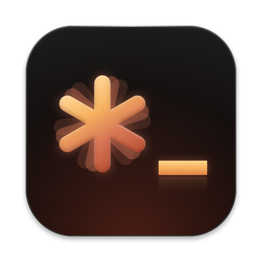
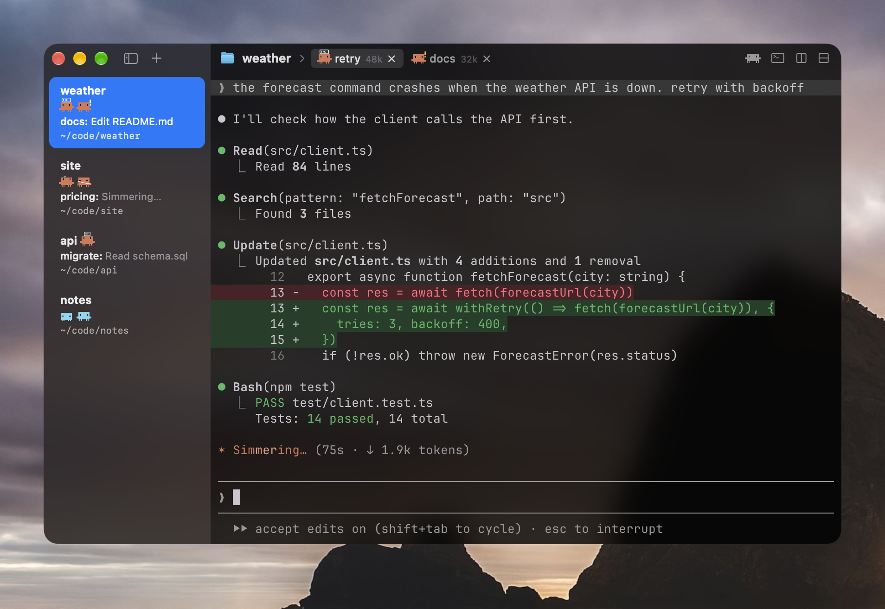
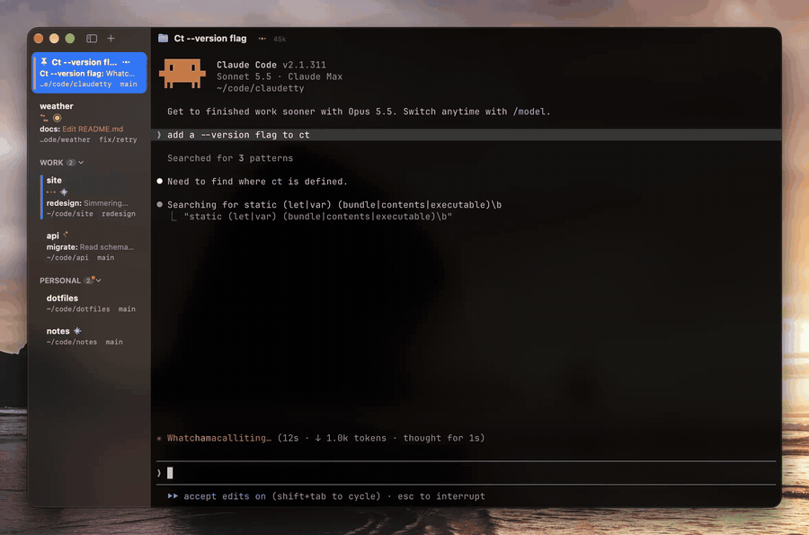
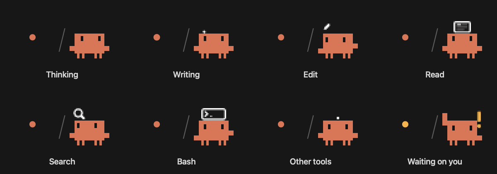
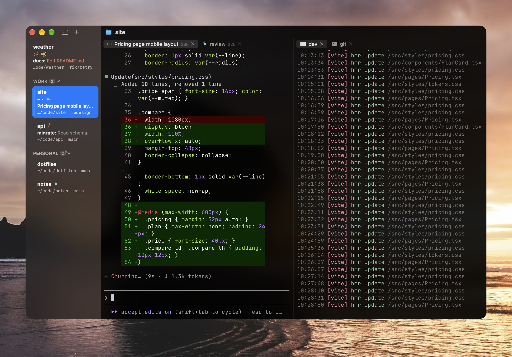
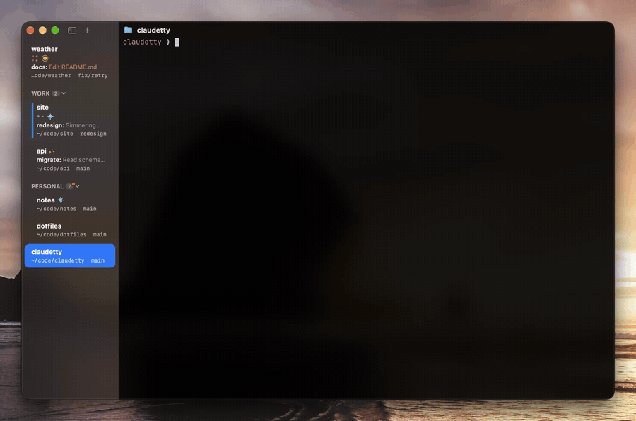
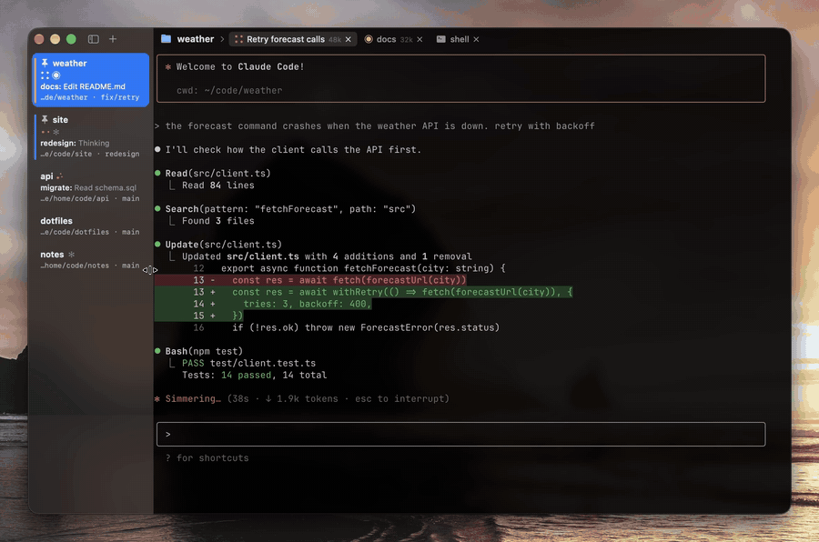

<div align="center">
  <h1> ClaudeTTY</h1>
  <p>A fast, undying cmux for Claude Code.</p>
  <p><a href="https://github.com/aqilc/ClaudeTTY/releases/latest/download/ClaudeTTY.dmg"></a><br><sub>macOS 26 or later, Apple Silicon</sub></p>
</div>



Looks (top tier, animated throughout)
-------------------------------------



### Persistent Tabs

Every tab runs in a [zmx](https://github.com/neurosnap/zmx) session outside the app, like tmux without the tmux. Quit it, crash it or update it, and every Claude is still mid-edit when you open it again. Same when Claude Code updates itself. The Claudes you already had open stay up and still get tracked. After a reboot I get each tab back in its group with `claude --resume`.

<br clear="all"><br>



### Dots and Clawd

Pick Dots or Clawd in View > Icons. When a Claude needs you its tab turns amber, so with 4 Claudes in a group you can tell which one it is. You can also see how much context each tab has used.

<br clear="all"><br>



### Groups and panes

I keep each project in a group and its Claudes as tabs. I color and pin groups, and the splits and shortcuts are the ones you know from iTerm, and <kbd>⌘</kbd>-click opens links and file paths even while Claude Code has the mouse.

<br clear="all"><br>



### Modding it

The whole app is about 5,500 lines of Swift in three files, so it's pretty easy to mod. Change something (or ask Claude to), run `./install.sh` and the open window switches to the new build like magic, tabs and all.

<br clear="all"><br>



### Animations and polish

I made dragging tabs, groups and the sidebar feel right. Dragging the sidebar shut is pretty satisfying, or <kbd>⌘</kbd><kbd>B</kbd> for less satisfaction but some more practicality.

<br clear="all"><br>

Smaller Things I Like
---------------------

- Tabs sleep like Chrome's after 20 idle minutes, and wake into the same session.
- A cold cache turns a sleeping Claude icy cyan. View > Keep Asleep Tabs Warm prevents it.
- Right-click a tab for its model, effort and context.
- The sidebar names the background command a Claude is waiting on.
- Click "3 agents" under a group to watch a subagent work live.
- Idle groups show their Claude's last message, so I remember what I was doing.
- The dots wait a quarter second, so quick file reads don't turn into a strobe light.
- The tab bar picks up vim's background color, or any app's.
- <kbd>⌘</kbd>-click runs `~/.config/claudetty/open`, so files open in your editor.
- <kbd>⌘</kbd><kbd>P</kbd> <kbd>↩</kbd> is basically <kbd>⌘</kbd><kbd>Tab</kbd> for tabs.
- Right-click a tab to schedule a message for when your limits reset.

Compared to cmux and Others
---------------------------

| | ClaudeTTY | cmux | herdr | Superset | Warp | Wave | Ghostty |
|---|:-:|:-:|:-:|:-:|:-:|:-:|:-:|
| Tabs keep running after a quit or crash | ✅ | only through tmux | until its server restarts | ✅ | ❌ | SSH only, opt-in | ❌ |
| Shows what each Claude is doing | ✅ | a needs-attention ring | working and blocked | working and done | with its plugin | ❌ | ❌ |
| Claude can run other tabs | ✅ | CLI and socket | CLI and socket | CLI, MCP and SDK | ❌ | `wsh` CLI | ❌ |
| Memory with one idle tab | 68 MB | 1,029 MB (15×) | 109 MB | 359 MB | 895 MB | 556 MB | 84 MB |
| Idle CPU | 0.03% | 3.1% (103×) | 0.9% | 1.9% | 3.2% | 1.9% | 0.7% |
| Launch to first window | 307 ms | 701 ms | not timed | 889 ms | 829 ms | 1,226 ms | 302 ms |
| App size | 20 MB | 454 MB | 86 MB | 1.5 GB | 872 MB | 531 MB | 62 MB |

<sub>All on my M4 Pro (48 GB) with macOS 27.0 and one window with one tab. Launch is the median of 5, memory is Activity Monitor's footprint 20 s after launch (ClaudeTTY's includes the zmx process holding the tab) and CPU is over the 30 s after that. cmux 0.65.2, Superset 1.39.0, Warp 0.2026.10.14 and Wave 0.14.5 on fresh profiles, Ghostty 1.3.1. herdr 0.9.5 runs inside your terminal, so its numbers are herdr plus Ghostty (herdr alone is 25 MB, 0.2% and 24 MB). Closing the terminal keeps its tabs running, but a server restart ends them (<a href="https://herdr.dev/docs/session-state/">herdr docs</a>). Without tmux, cmux reopens your layout and restarts Claude into its last conversation, but whatever was running is gone (<a href="https://github.com/manaflow-ai/cmux">cmux README</a>).</sub>

Letting Claude Run Your Tabs
----------------------------

ClaudeTTY installs a Claude Code plugin and a `ct` command, so the Claude in one tab can open, watch and steer the others:

```sh
ct list                          # every tab, its group, folder and Claude state
ct web dev bun run dev           # open tab "dev" in group "web", running a command
ct split dev right agent claude  # a new pane beside it with Claude in it
ct wait agent idle               # block until that Claude is done
zmx send agent "run the tests"   # type into it
```

Don't even look at this, this is meant so your Claude has fine grained orchestration abilities and can accept prompts and other things for you without you ever having to step in. My terminal teaches it to Claude automatically, in as few tokens as possible (~75 to be exact).

Install
-------

[Download ClaudeTTY.dmg](https://github.com/aqilc/ClaudeTTY/releases/latest/download/ClaudeTTY.dmg), open it and drag ClaudeTTY to Applications.

<details>
<summary>Build from source</summary>

You need Xcode and Zig 0.16 (`brew install zig@0.16`).

```sh
./deps.sh     # builds GhosttyKit from pinned, patched Ghostty source and fetches zmx
./install.sh  # builds and signs ~/Applications/ClaudeTTY.app
```

install.sh signs with your Apple Development identity if you have one and otherwise offers to make a local one, so macOS remembers the app's permissions between builds. It also restarts the app, everything running as it was.
</details>

Limitations
-----------

I think it's pretty much done, so apart from bugs and small niceties I won't be adding much. If you need something else there's probably a terminal tool for it, like [terminal-browser](https://terminal-browser.com/) for the web or [ttt](https://github.com/eugenioenko/ttt) (I used vim anw). And since ClaudeTTY is fast they run better here than in a lot of dedicated GUI apps, even cmux. Ask your agent to add the functionality you need for those tools.

I turned pull requests off for the same reason. If you want it to do something else, fork it and change it. I'm happy to see bug reports and cool feature requests that land with my philosophy in Issues.

License
-------

[CC BY-NC-SA 4.0](LICENSE)

FAQ
---

### Why make another terminal?

> I used cmux for a while and loved the layout, but it was buggy for me. It crashed a lot, updates killed everything I had running (which hurts when Claude's in the middle of an edit), it leaked memory and it'd pile up a bajillion unread notifications that didn't even work properly. It also only really tracks one Claude per workspace.
>
> So I kept the parts I liked, groups in the sidebar and tabs in the titlebar with the same shortcuts, and left out the browser, file viewer and port lists since I barely opened them. I let Claude write the code and only step in for an edit now and then, so I don't need a file tree or an editor either. Edits I would make also feel worthless since they're just normal code anyways, so it's going to get replaced eventually.
